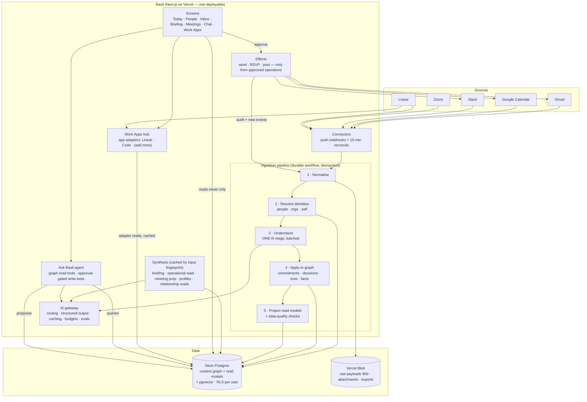
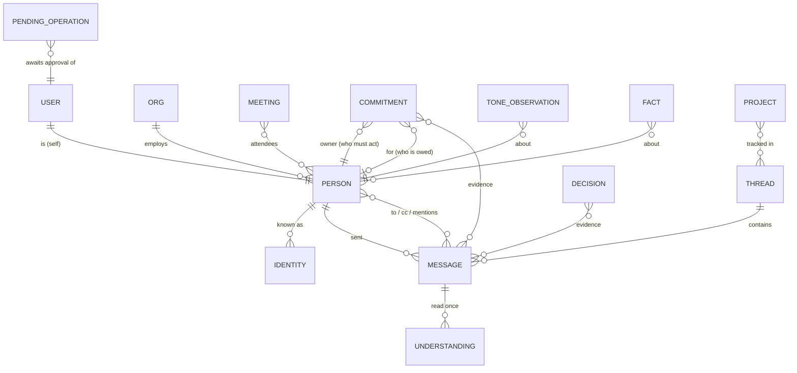

# Basil — Architecture Redesign (clean rebuild)

Status: **Proposed — open questions answered 2026-10-14** · Author: Claude with Michael · 2026-10-14
Decisions: [ADR index](adr/README.md)

## 1. Why redesign

Basil works, but it was grown feature by feature, and each feature brought its own
pipeline, storage file and rules. The live audit of 2026-10-09 → 14 traced almost every
user-visible failure to that shape, not to individual bugs:

| Symptom Michael saw | Structural cause |
|---|---|
| Other people's tasks on "my" list; actions 11 → 33 in four days | **Four** separate paths turn a meeting into "actions" (action items, follow-ups, blockers, decision consequences), each with its own idea of an owner |
| "Logan has gone quiet" while he messaged that week | **Two** "last contact" sources (stored date vs live scan) that disagree |
| Malcolm "cooling" over frustration aimed at a colleague | **Three** classifiers (email, Slack, Zoom) each with their own tone rules |
| Reply-all put Michael on his own Cc | "Who is me" known in one place (settings) and not another (mail) |
| "Reply to Carter: are you on the call?" a day after the call | Asks have no notion of expiry |
| Deleted logins came back; deleted contacts reappeared | Whole-file JSON documents in Blob, read-modify-written, read through a CDN that served stale copies |
| Other logins read Michael's Slack and mail | Shared env-var credentials as a fallback for every user |
| Slack Command Centre: 40 s to load; profiles slow | Live API fan-out on page load |
| A duplicate "Stig" briefing costing 10% of AI spend | A second briefing engine beside the first |
| Reopened conversations broke on the next message | Approval state lived inside chat-history parts |

Patching each one fixed the instance, not the class. The redesign removes the classes.

## 2. Requirements

### 2.1 Users and usage (measured)
- **You plus a handful of people** (decided 2026-10-14). One primary user done excellently; extra users must be isolated and safe, with no scaling work.
- **Measured traffic, last 7 days:** mostly background jobs. Of the screens you open, the most used are Today, People (activity, profiles, tone), the Briefing, Meeting prep, Ask Basil and the Calendar.
- **Volume (Michael):** about 100 Slack messages a week (574 a month across 17 active conversations), about 23 curated contacts, 1,810 memories, about 430 actions all-time and 7.6 MB of state.
- **AI spend:** $204 from June to October. The daily cap is about $2.

### 2.2 Functional (kept)
| # | Capability | Notes |
|---|---|---|
| F1 | Connect your own accounts: Google (Gmail, Calendar, Drive), Slack, Linear, coding tools | per-user OAuth only. **Zoom is not connected** (it can't be connected); meetings come from Zoom's recap emails via Gmail. Decided 2026-10-14 |
| F2 | Continuous ingestion: email, Slack (channels, DMs, group DMs, threads), calendar and RSVPs, Zoom recap emails, Linear issues | push where possible, reconcile poll |
| F3 | **Know who's who:** one Person per human across email, Slack and Zoom; people vs organisations; internal vs external; your own identities and aliases | the foundation for trust |
| F4 | **Understand each message once:** needs a reply? asks you to act? who committed to what, for whom, by when? decision? tone towards *you*? how long is it valid? | one shared rule set |
| F5 | Today: priorities, *genuinely* awaiting reply, your commitments vs waiting-on, day shape, relationships needing attention | |
| F6 | People: one last-contact date, relationship timeline, tone and trend with evidence, personality profile with **"last updated N days ago"**, quiet detection | profile age requested 2026-10-14 |
| F7 | Email in Basil: read, reply / reply-all / Cc / Bcc, AI draft; RSVP accept / decline / propose | |
| F8 | One briefing (daily, plus a cached on-demand operational read) and meeting prep | Stig merged in |
| F9 | Ask Basil: reads from the context graph; write actions only after approval; conversations resumable | |
| F10 | Memory and glossary with provenance, decay and expiry | |
| F11 | Project radar (real projects, not tool names) | **Linear issues feed the radar only, not your commitments.** Decided 2026-10-14 |
| F12 | Admin: users, health, spend, backups | |
| F13 | **Work Apps tab:** one left-hand navigation item that toggles between Linear, Code (AI coding tools: Claude Code, Claude.ai projects, GitHub) and any app you add later | requested 2026-10-14; see ADR-0013 |

### 2.3 Cut or deferred (unused or duplicate)
- **Merged into F8:** the Stig engine and the Briefing's separate "operational read" pipeline.
- **Removed for now:** billing/dunning (no paying users); WhatsApp import (personal contacts deleted at your request); shadow pipelines and the shadow log; learning priors.
- **Maybe later:** Siri/voice, as a client of the agent API (no use logged so far; Michael: "maybe").
- **Kept, but moved:** AI coding-tool tracking becomes the **Code** app inside the Work Apps tab (F13).
- **Deferred until needed:** Microsoft 365 / Teams (currently disconnected).

### 2.4 Non-functional
| Area | Requirement |
|---|---|
| **Trust (primary)** | Every item shown traces to its source messages (provenance link). One canonical record per person, thread and commitment; derived facts are computed from the graph, never stored twice. Ingestion is idempotent. Data-quality checks run after every pipeline batch, with **zero tolerance** for known failure classes: self as recipient; another person's task shown as yours; duplicate people; expired asks shown as open; orgs treated as people. |
| Freshness | Email, Slack and calendar visible within 5 min (push), 15 min worst case (reconcile). Every view shows "as of". |
| Performance | Screens read precomputed views: p95 API < 300 ms, no third-party API calls on page load. Ask Basil first token < 3 s. |
| Cost | AI ≤ $1/day typical for the primary user, with a hard per-user daily cap (current $2) and per-stage budgets. Infra ≤ $25/mo beyond Vercel Pro. |
| Availability | 99.5%. Degraded mode serves the last good views with "as of" rather than an error. |
| Reliability | RPO ≤ 1 h (Postgres point-in-time restore), RTO ≤ 4 h. Raw source payloads kept 90 days, so any stage can be replayed after a fix. |
| Security | Per-user credentials only (no shared fallbacks). Tokens encrypted with envelope keys. Postgres row-level security by `user_id`. Every outbound action (send, RSVP, post) is approval-gated and audited. Minimal OAuth scopes. Secrets never enter prompts. |
| Maintainability | Modular monolith with typed schema and migrations. AI stages have evals built from real (anonymised) cases. Replayable fixtures. ADRs for decisions. |
| Scale | ≤ 10 users and ≤ 50k messages per user per year. Deliberately no sharding, microservices or cache tier. |

### 2.5 Constraints
- Vercel (Pro) and Next.js stay as the platform. AI through the AI SDK, with Anthropic models first.
- One developer (Michael plus Claude). The design must stay operable by one person.
- **Clean rebuild** (decided). The current app runs in maintenance-only mode until cut-over.

## 3. Architecture

### 3.1 Shape: a modular monolith with one pipeline and a context graph

**Key properties**
- **One way in.** Every source becomes normalised `messages` or `events` before anything else looks at it. Nothing reads Gmail or Slack directly except the connectors and the effects.
- **One understanding.** A single AI stage reads each message once, with one rule set. Commitments, needs-reply, tone and decisions all come from that one structured output.
- **One truth, many views.** Screens read **read models** (precomputed tables) that the projector keeps current. Pages never fan out to Gmail or Slack.
- **Writes out only through Effects,** and only from an approved pending operation.

### 3.2 The context graph (Postgres)

Core rules the schema enforces:
- **IDENTITY** has a unique `(user_id, kind, value)`, where kind is email, slack_id, zoom_email or display_name. One identity belongs to exactly one PERSON. Merges are recorded and can be undone.
- **Self is a PERSON** with every identity the user has: mailbox, aliases (from Gmail send-as), Slack ID (from `auth.test`), names. "Is this me?" is a single join, used everywhere (fixes self on Cc, phantom contacts, and replies to yourself).
- **PERSON.kind** is `person | org | bot`. Newsletters and apps (Google Calendar, GlobalData) are never "relationships".
- **COMMITMENT.owner** is required. *Mine* is `owner = self`; *waiting on* is `for = self AND owner ≠ self`. There is no unowned "action".
- **COMMITMENT and needs-reply carry `valid_until`.** "Join the call now" expires with the call, and a sweep closes it with the reason `expired`.
- **Last contact** is a **view** (`max(message.sent_at)` per person across every source). It is never a stored field that can drift.

### 3.3 Read models (what the screens read)
| View | Built from | Refreshed |
|---|---|---|
| `today_view` | commitments (mine, due/overdue), needs-reply (open, valid), meetings today, relationship risks | after each pipeline batch, plus a 5-min validity sweep |
| `people_view` | persons (kind = person) with last_contact, tone trend, profile_age_days, open commitments both ways | after each batch |
| `inbox_view` | threads where the latest message needs *your* reply and is still valid | after each batch |
| `commitments_view` | mine / waiting-on / done, with evidence links | after each batch |
| `slack_view` | Slack threads that need you, blockers, promises (from understanding, not regex) | after each batch |

### 3.4 Pipeline stages
1. **Normalise.** Turn the source payload into `message` or `event`. The raw payload goes to Blob (90 days); the idempotency key is source plus source id plus content hash.
2. **Resolve.** Match sender and recipients to IDENTITY → PERSON, creating unconfirmed people where needed. Slack directory sync fills in emails, titles and whether someone is internal; domain rules mark internal; known bots and newsletters become `kind = bot | org`.
3. **Understand** (Haiku, batched about 20 messages per call, structured output). One schema returns: `needs_reply`, `reply_valid_until`, `asks[]`, `commitments[] {by, for, text, due}`, `decisions[]`, `tone_towards_self`, `facts[]`, and `is_notification`. One rule set covers every source. Evals: every failure from the 2026-10 audit becomes a fixture.
4. **Apply.** Upsert commitments, decisions, tone and facts with evidence links. Re-evaluate open commitments and needs-reply in the same thread ("answered elsewhere", "fulfilled", "superseded").
5. **Project.** Refresh the affected read-model rows, then run the data-quality checks. A violation is logged *and* hides the offending row rather than showing something wrong.

### 3.5 Synthesis (Opus, cached)
Each artefact (briefing, operational read, meeting prep, profile, relationship read) is stored in `generated_artifacts` with an **input fingerprint** over the graph rows it read. It's rebuilt only when that fingerprint changes and a minimum age has passed, or when you click Refresh. That generalises the caching built on 2026-10-13 for the Stig read (103k → 17.6k tokens, $0.46 → $0.18) to every artefact.

### 3.6 Ask Basil
- **Tools are graph queries:** people, commitments, threads, calendar, facts. They're fast, cheap and consistent with the screens. Live-source tools (search the whole mailbox) are the exception, not the default.
- **Write tools create a `pending_operation`** (draft, recipients, effect) and return its id. The UI approves or denies it, and Effects executes it. Approval state lives in the database, not in chat parts, so conversations resume cleanly.
- **Conversations** are stored as messages with full tool calls and results (no lossy receipts).

### 3.7 AI gateway
Model routing by task tier, as in today's `model-config`:
- Understand → Haiku
- Synthesise → Opus or Sonnet
- Chat → Opus

Every structured call uses native structured output. Prompt caching is on for stable prefixes. Every call is metered into `ai_spend`, with per-stage and per-user daily budgets and a circuit breaker that degrades work instead of failing it (understanding queues, synthesis serves the last artefact). Evals run in CI.

### 3.8 Cost model (primary user, typical day)
| Stage | Volume | Est. cost |
|---|---|---|
| Understand (Haiku) | ~150 messages → ~8 batched calls | ~$0.08 |
| Relationship reads (Haiku) | ~10 changed contacts | ~$0.03 |
| Daily briefing (Opus) | 1 | ~$0.15 |
| Operational read (Opus, cached) | ≤ 2 rebuilds | ~$0.36 |
| Meeting prep / profiles / chat | on demand | ~$0.10–0.40 |
| **Total** | | **~$0.70–1.00/day** (vs $0.23–1.82 now, with spikes) |

Infra: Neon at about $0–19/mo (small instance, point-in-time restore), Blob at pennies, Vercel Pro already paid.

## 4. Failure modes
| Failure | Impact | Mitigation |
|---|---|---|
| Push webhook missed (Gmail, Calendar, Slack) | Item late | 15-min reconcile from per-source cursors |
| Source API rate limit | Ingestion pauses | Durable workflow retries with backoff; cursors never advance past unprocessed data |
| AI stage fails or budget hit | No new understanding | Messages wait in `understanding_queue`; views stay correct-but-stale with "as of"; an alert fires |
| Bad AI output | Wrong commitment or tone | Structured output plus validation; confidence threshold → review queue; evals block regressions |
| Postgres outage | Screens down | Neon high availability; RPO ≤ 1 h via point-in-time restore; nightly export to Blob |
| Token revoked (like `sage` on 2026-10-10) | Source stops | Health check per connector; a "Reconnect" banner; never fall back to another user's credentials |
| Wrong identity merge | Mixed-up person | Merges recorded and reversible; the UI shows "merged from …" |

## 5. Delivery plan (clean rebuild)
| Phase | Scope | Exit criteria |
|---|---|---|
| **0 Foundations** | New repo `basil-next`; Neon, schema and migrations (Drizzle); auth and token vault; AI gateway; observability; CI gates | Sign in, connect Google and Slack; spend metering visible |
| **1 Ingest and resolve** | Google and Slack connectors (push + reconcile), normalise, identity resolution, Slack directory sync; 60-day backfill | Data-quality report: 0 duplicate people, self resolved across all aliases, orgs and bots separated |
| **2 Understand and project** | The one understanding stage with evals (built from the audit's real cases); commitments, needs-reply, validity sweep; Today, People, Inbox screens | Side-by-side with today's Basil on the same week: no wrong-owner actions, no expired asks, correct last contact |
| **3 Act and converse** | Email in-app, RSVP, pending operations and Effects; Ask Basil; briefing, operational read, meeting prep, profiles; Zoom recap-email parsing; Work Apps hub with Linear and Code adapters | All F1–F13 working; cost ≤ $1/day over a week |
| **4 Migrate and cut over** | Import curated contacts, profiles, notes, memories (de-duplicated), open commitments, decisions and glossary from Blob, with dry-run diff reports; 1–2 weeks shadow-running; switch the domain; old app read-only for 30 days, then retired | You sign off on the shadow comparison |

The current app stays in maintenance-only mode during phases 0–3: security and breakage fixes only.

## 6. Risks
| Risk | Mitigation |
|---|---|
| Rebuild takes long; current features stall | Scope cuts above; phase exit criteria; current app kept healthy for small fixes |
| Migration loses curated knowledge (profiles, notes) | Import scripts with dry-run diffs that you review; Blob backups kept 90 days after cut-over |
| Durable-workflow platform maturity | ADR-0004 fallback: a Postgres job table drained by a 1-minute cron |
| One understanding prompt becomes a bottleneck | Versioned prompt and schema; evals; per-source sections inside one shared rule set |
| Identity resolution errors | Unconfirmed people need either an identifier match or your confirmation; reversible merges |
| Cost creep | Per-stage budgets, a daily spend report, and synthesis only on fingerprint change |

## 7. Decisions on the open questions (Michael, 2026-10-14)
1. **Zoom:** Zoom can't be connected, so keep the meeting features and continue using **recap emails via Gmail** for now. The Zoom API connector stays a later option.
2. **Linear:** issues do **not** become commitments; they feed the project radar. Linear and Code are combined under **one left-hand tab** that toggles between apps, extensible to any app added later (F13, ADR-0013).
3. **Other users:** **completely separate** data (ADR-0010 as designed).
4. **Siri/voice:** **maybe later**, as a client of the agent API; not in the rebuild scope.
